# FERQUEUE

FERQUEUE adalah sistem manajemen antrean kendaraan untuk proses masuk kapal feri. Sistem menggabungkan timbangan berbasis load cell, ESP32, servo gate, web monitoring, backend, dan Computer Vision untuk mencatat kendaraan, mengatur antrean parkiran, menentukan kendaraan yang boleh masuk feri, dan memantau proses boarding.

## Gambaran proyek

Sistem dibagi menjadi empat bagian utama:

- **Gate awal** — load cell dan HX711 membaca berat kendaraan, sedangkan ESP32 mengendalikan servo.
- **Web monitoring** — operator memasukkan jenis dan warna kendaraan, melihat berat, antrean, kapasitas feri, serta status boarding.
- **Backend dan sistem cerdas** — menyimpan data, membuat nomor antrean, menentukan kendaraan yang boleh boarding, dan menjadi pusat komunikasi seluruh komponen.
- **Computer Vision** — menggunakan satu kamera di parkiran dekat jalur masuk feri untuk mendeteksi kendaraan yang benar-benar bergerak menuju feri.

Jenis dan warna kendaraan digunakan untuk membantu identifikasi, tetapi setiap kendaraan tetap memiliki `queue_id` unik karena beberapa kendaraan dapat mempunyai jenis dan warna yang sama.

## Pembagian jobdesk

| Anggota | Tanggung jawab | Folder kerja |
| --- | --- | --- |
| Hillan | Computer Vision: kamera, ROI, virtual line, deteksi jenis dan warna, tracking, serta penghitungan kendaraan yang masuk feri | `apps/computer-vision/`, `models/mobilenet/`, `data/` |
| Zafar | Sistem tertanam: ESP32, load cell, HX711, kalibrasi berat, servo gate, telemetry, dan mekanisme fail-safe | `firmware/esp32-gate/` |
| Zaki | Backend dan sistem cerdas: kontrak data, database, API, antrean, perhitungan kapasitas, keputusan boarding, serta integrasi seluruh komponen | `apps/backend/`, `shared/contracts/` |
| Akbar | Web monitoring: form pendataan kendaraan, dashboard antrean, konfigurasi feri, monitoring boarding, dan status perangkat | `apps/web-monitoring/` |

> `firmware/esp32-gate/` dan `shared/contracts/` adalah lokasi kerja yang direncanakan dan perlu dibuat saat implementasinya dimulai.

## Alur sistem

1. Kendaraan datang ke gate awal dan berhenti di atas load cell.
2. ESP32 membaca berat sampai stabil dan mengirimkannya ke backend.
3. Operator memilih jenis dan warna kendaraan melalui web.
4. Backend memvalidasi data, membuat `queue_id`, dan menyimpan kendaraan.
5. Backend mengirim perintah kepada ESP32 untuk membuka servo gate.
6. Kendaraan masuk ke parkiran dan statusnya menjadi `waiting`.
7. Operator memasukkan batas jumlah dan berat feri melalui web.
8. Sistem cerdas memilih kendaraan berdasarkan antrean dan kapasitas feri.
9. Kendaraan terpilih mendapatkan status `allowed_to_board`.
10. Kamera di parkiran memantau kendaraan yang melewati jalur masuk feri.
11. Backend mencocokkan event kamera dengan daftar kendaraan yang diizinkan.
12. Kendaraan yang terkonfirmasi masuk feri mendapatkan status `boarded`.

```mermaid
flowchart LR
    A[Kendaraan datang] --> B[Load cell membaca berat]
    B --> C[Operator mengisi jenis dan warna]
    C --> D[Backend membuat queue_id]
    D --> E[Servo gate terbuka]
    E --> F[Kendaraan menunggu di parkiran]
    F --> G[Sistem memilih sesuai kapasitas feri]
    G --> H[Daftar kendaraan yang boleh boarding]
    H --> I[Kamera memantau jalur masuk feri]
    I --> J[Backend mencocokkan kendaraan]
    J --> K[Status boarded]
```



## Cara kerja setiap komponen

### Computer Vision

- Kamera hanya berada di parkiran dekat jalur masuk kapal feri.
- Sistem mendeteksi jenis dan warna kendaraan sebagai bantuan pencocokan.
- Tracking dan virtual line digunakan agar satu kendaraan hanya dihitung satu kali.
- Computer Vision hanya mengirim event pengamatan dan tidak menentukan izin boarding.

### Sistem tertanam

- Load cell dan HX711 menghasilkan berat dalam kilogram.
- ESP32 menunggu sampai pembacaan berat stabil sebelum mengirim data.
- Servo hanya bergerak setelah menerima perintah valid dari backend.
- Jika sensor, Wi-Fi, atau backend bermasalah, gate harus berada dalam kondisi aman atau tertutup.

### Backend dan sistem cerdas

- Backend menjadi sumber utama data dan status kendaraan.
- Sistem menyimpan berat, jenis, warna, waktu masuk, nomor antrean, dan riwayat status.
- Pemilihan kendaraan mempertimbangkan urutan antrean, batas jumlah, dan total berat feri.
- Setiap keputusan harus memiliki alasan dan tidak boleh melebihi kapasitas feri.
- Event duplikat dan perintah gate harus ditangani secara idempotent.

### Web monitoring

- Operator melihat berat realtime dan mengisi jenis serta warna kendaraan.
- Web menampilkan antrean parkiran, kendaraan yang diizinkan, dan kendaraan yang sudah boarding.
- Web menyediakan input kapasitas feri dan penyelesaian manual ketika hasil kamera ambigu.
- Web hanya berkomunikasi dengan backend melalui REST API dan WebSocket.

## Status kendaraan

| Status | Keterangan |
| --- | --- |
| `weighing` | Kendaraan sedang ditimbang |
| `registered` | Berat, jenis, dan warna sudah tersimpan |
| `waiting` | Kendaraan menunggu di parkiran |
| `allowed_to_board` | Kendaraan diizinkan masuk feri |
| `boarded` | Kendaraan terkonfirmasi masuk feri |
| `hold` | Kendaraan ditahan atau perlu pemeriksaan |
| `cancelled` | Pencatatan kendaraan dibatalkan |

## Struktur repository

```text
ferqueue/
├── apps/
│   ├── backend/             # Backend dan sistem cerdas
│   ├── computer-vision/     # Deteksi dan tracking kendaraan
│   └── web-monitoring/      # Dashboard operator
├── firmware/
│   └── esp32-gate/          # Firmware ESP32, load cell, dan servo
├── shared/
│   └── contracts/           # Kontrak payload/API lintas komponen
├── data/                    # Dataset lokal
├── models/
│   └── mobilenet/           # Model Computer Vision lokal
└── scripts/                 # Script pengujian dan development
```

## Aturan integrasi

- Backend menjadi pusat komunikasi; web, ESP32, dan Computer Vision tidak berkomunikasi langsung satu sama lain.
- Gunakan `queue_id` sebagai identitas utama kendaraan.
- Gunakan UUID untuk event dan perintah.
- Gunakan waktu ISO 8601 UTC dan berat dalam kilogram.
- Retry harus memakai ID yang sama agar tidak membuat data duplikat.
- Perubahan kontrak data harus dibahas bersama sebelum diterapkan.
- Dataset, model besar, password Wi-Fi, token, dan kredensial tidak boleh dimasukkan ke Git.

## Kondisi saat ini

Repository masih berada pada tahap scaffold awal. Struktur folder utama sudah tersedia, tetapi implementasi backend, Computer Vision, firmware, web, kontrak data, spesifikasi perangkat, model final, dan aturan kapasitas masih perlu dikerjakan serta diuji bersama.
