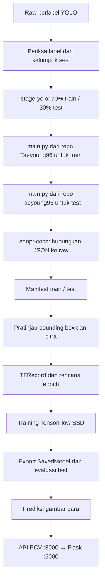

# Panduan PCV manual: dataset berlabel sampai web

Dokumen ini adalah alur utama PCV yang baru. Jalankan setiap perintah sendiri, satu per satu; periksa hasil satu tahap sebelum lanjut. Semua tahap menggunakan `python pcv.py <tahap>`; instalasi dependensi dan converter eksternal tetap dijalankan manual. `pcv.py` hanya menjalankan operasi yang kamu pilih memakai Python aktif, tanpa memasang software atau memilih environment lain.

Target utama: **Linux native, CPU Ryzen, Python 3.11 64-bit, TensorFlow 2.15.1, SSD MobileNet V2 FPNLite 320×320**. Radeon iGPU laptop tidak dipakai oleh backend ini. Windows bisa dipakai untuk persiapan data dan inference; training paket proyek ini dijalankan pada Linux/WSL2. GPU NVIDIA opsional dibahas di bagian 15.

Kode disiapkan untuk kamu jalankan. Instalasi software, konversi dataset asli, training, pemilihan model, dan menjalankan web adalah pekerjaan manual di perangkatmu. Perintah dalam satu blok tetap dijalankan berurutan, bukan ditempel sebagai script yang berjalan tanpa diperiksa.

## 1. Peta proses dan hasil setiap tahap



SSD memprediksi kelas dan bounding box kendaraan dari gambar utuh. Denoise, CLAHE, dan gamma yang kamu aktifkan diterapkan pada TFRecord, evaluasi, prediksi gambar, dan API web dengan posisi kotak yang sama. Jika melakukan crop atau rotasi setelah labeling, sesuaikan koordinat kotak sebelum membuat manifest.

| Tahap | Input | Output utama | Periksa sebelum lanjut |
| --- | --- | --- | --- |
| Raw | Gambar, `.txt`, `classes.txt`, sesi | `data/raw/vehicles/` | Label sesuai gambar dan urutan kelas benar |
| Inspect | Raw YOLO | Ringkasan di terminal | Jumlah kelas, background, kelompok, objek |
| Staging | Raw valid | `data/processed/pcv-converter-v2/` | Daftar train/test, salinan gambar/label, kelas |
| Konversi eksternal | Daftar train/test | `.cache/yolo-to-coco/output/instances_*.json` | Hasil `main.py` repo Taeyoung96 |
| Adopt | JSON eksternal + staging | `data/processed/pcv-coco-v2/` | Path gambar raw, kelompok, kategori, bbox |
| Prepare | Gambar raw + COCO | `data/processed/pcv-coco-manifest-v2/` | `summary.json` dan peringatan kelas |
| Preview | Manifest + parameter citra | `outputs/pcv-preview-v1/` | Perbandingan asli/hasil dan kotak |
| Records | Manifest + preprocessing | `run_dir/records/`, `label_map.pbtxt` | Dua TFRecord dan `training-plan.json` |
| Training | Records + pretrained COCO | `run_dir/training/` | Loss, checkpoint, TensorBoard |
| Export/evaluasi | Checkpoint | `exports/`, `export.json`, `reports/` | mAP test dan prediksi visual |
| Integrasi | Model yang dipilih | API + halaman kamera | Health, kelas, threshold, bbox |

## 2. Pasang software dan environment dasar

### 2.1 Software pendukung

Gunakan terminal Linux untuk alur utama. Siapkan browser, file manager yang bisa membuka ZIP/TAR, dan editor seperti [VS Code](https://code.visualstudio.com/download). Editor lain juga boleh. Git dipakai untuk mengambil repo converter yang kamu pilih. Node.js, database, kamera, CUDA, dan ESP32 belum diperlukan untuk mengolah data/training CPU.

Library gambar membutuhkan library sistem OpenGL/GLib pada sebagian distro. Jika belum tersedia, jalankan perintah sesuai distro, bukan keduanya:

Fedora:

```text
sudo dnf install git gcc gcc-c++ make unzip mesa-libGL glib2
```

Ubuntu/WSL Ubuntu:

```text
sudo apt update
sudo apt install git build-essential unzip libgl1 libglib2.0-0 python3-venv
```

Buka terminal pada root folder `ferqueue`. Pada perangkat sekarang:

```text
cd /home/foxxyy/project/ferqueue
pwd
```

Pada komputer lain, ganti lokasi `cd` sesuai foldermu. Semua perintah berikutnya dijalankan dari root ini kecuali dinyatakan lain.

### 2.2 Python 3.11

Periksa apakah Python 3.11 sudah ada:

```text
python3.11 --version
```

Jika tersedia, buat environment PCV langsung:

```text
python3.11 -m venv .venv-pcv
```

Jika Python sistemmu versi lain dan `python3.11` tidak tersedia, gunakan `uv` sebagai pengelola Python. Berikut perintah manual untuk memasang tool tersebut dalam environment terpisah, lalu mengunduh Python 3.11. Lewati pembuatan `.venv-tools` jika environment itu sudah tersedia:

```text
python3 -m venv .venv-tools
.venv-tools/bin/python -m pip install uv
.venv-tools/bin/uv python install 3.11
.venv-tools/bin/uv venv --python 3.11 --seed .venv-pcv
```

Pilih salah satu cara pembuatan `.venv-pcv`; jangan membuat ulang environment yang masih kamu pakai. `uv python install` mengunduh distribusi Python yang dikelola uv. [Instalasi uv](https://docs.astral.sh/uv/getting-started/installation/) dan [pengelolaan versi Python](https://docs.astral.sh/uv/guides/install-python/).

Aktifkan environment pada terminal ini:

```text
source .venv-pcv/bin/activate
python --version
python -c "import sys; print(sys.executable)"
python -m pip install --upgrade pip
python -m pip install -r apps/computer-vision/requirements/data.txt
python -c "import PIL, cv2, numpy; print(PIL.__version__, cv2.__version__, numpy.__version__)"
```

Periksa Python **3.11.x**, executable di `.venv-pcv`, Pillow **10.4.0**, OpenCV **4.10.0**, dan NumPy **1.26.4**. Paket ini cukup untuk inspect, konversi, prepare, dan preview. TensorFlow diperlukan mulai bagian 9.

`source` hanya mengaktifkan virtual environment Python, bukan menjalankan pipeline PCV. Setiap membuka terminal baru untuk PCV, masuk root repo dan aktifkan environment lagi. Alternatifnya panggil `.venv-pcv/bin/python` secara lengkap.

## 3. Pasang TensorFlow dan Object Detection API secara manual

### 3.1 Dependensi training CPU

Dalam `.venv-pcv`:

```text
python -m pip install -r apps/computer-vision/requirements/training.txt
python -m pip check
python -c "import tensorflow as tf; print(tf.__version__); print(tf.config.list_physical_devices('GPU'))"
python -m tensorboard.main --version
```

TensorFlow harus **2.15.1**, TensorBoard **2.15.2**. Daftar GPU kosong merupakan hasil normal untuk laptop CPU/Radeon pada alur ini. Versi proyek dipatok untuk kompatibilitas dengan Object Detection API dan Keras 2.15; jangan menggantinya dengan versi TensorFlow terbaru secara terpisah. [Panduan instalasi TensorFlow](https://www.tensorflow.org/install/pip) menautkan persyaratan versi lama dan menjelaskan dukungan platform.

### 3.2 Ambil sumber Object Detection API

1. Buka [ZIP TensorFlow Models pada commit proyek](https://github.com/tensorflow/models/archive/40695ad8964145a90ae1abbcc740c086e7364eac.zip) di browser dan unduh.
2. Buat folder `.cache` di root repo lewat file manager. Aktifkan tampilan file tersembunyi bila perlu.
3. Ekstrak ZIP. Pindahkan/ubah nama folder hasil ekstraksi menjadi `.cache/tensorflow-models`.
4. Pastikan file `.cache/tensorflow-models/research/object_detection/protos/pipeline.proto` dan folder `.cache/tensorflow-models/research/slim` ada. Hindari lapisan folder ganda seperti `tensorflow-models/models-<commit>/research`.
5. Jika `.cache/tensorflow-models` sudah ada dari instalasi sebelumnya, periksa isinya; jangan menimpanya saat ada proses training yang berjalan. Jika ragu, simpan salinannya sebelum mengganti sumber.

Proyek membaca sumber dari lokasi ini melalui `configure_sources`; tidak perlu memasang ulang `object_detection` dari `master` atau menjalankan `pip install .` yang bisa mengganti dependensi. [Dokumentasi TF2 Object Detection API pada commit yang sama](https://github.com/tensorflow/models/blob/40695ad8964145a90ae1abbcc740c086e7364eac/research/object_detection/g3doc/tf2.md).

### 3.3 Compiler Protobuf

1. Unduh [protoc 3.20.3 Linux x86_64](https://github.com/protocolbuffers/protobuf/releases/download/v3.20.3/protoc-3.20.3-linux-x86_64.zip).
2. Ekstrak ke `.cache/protoc-3.20.3-linux-x86_64` sehingga executable berada di `bin/protoc`.
3. Dari root repo, berikan izin eksekusi dan periksa versi:

```text
chmod +x .cache/protoc-3.20.3-linux-x86_64/bin/protoc
.cache/protoc-3.20.3-linux-x86_64/bin/protoc --version
```

Hasilnya harus `libprotoc 3.20.3`. Kompilasi semua definisi Object Detection API:

```text
.cache/protoc-3.20.3-linux-x86_64/bin/protoc --proto_path=.cache/tensorflow-models/research --python_out=.cache/tensorflow-models/research .cache/tensorflow-models/research/object_detection/protos/*.proto
```

Periksa bahwa `.cache/tensorflow-models/research/object_detection/protos/pipeline_pb2.py` sudah terbentuk. Compiler protoc dan paket Python `protobuf` berbeda; keduanya memakai 3.20.3 di konfigurasi ini. [Rilis resmi Protocol Buffers 3.20.3](https://github.com/protocolbuffers/protobuf/releases/tag/v3.20.3).

### 3.4 Kompatibilitas decoder dan pemeriksaan environment

Jalankan perbaikan decoder tf-slim yang disediakan proyek. Perintah Python ini hanya mengganti import API kompatibilitas pada paket tf-slim di environment aktif, lalu menguji decoder JPG/PNG; tidak memasang dependensi atau melatih model:

```text
python pcv.py fix-tf-slim
python pcv.py check --config apps/computer-vision/configs/coco.json
```

`check` tidak memerlukan dataset atau checkpoint hasil training. Hasil akhirnya harus menyatakan forward pass SSD siap. Jika gagal, berhenti pada tahap ini dan baca error sebelum masuk training.

## 4. Ambil dan susun data raw yang sudah berlabel

1. Dari tempat datasetmu disimpan, unduh/salin ekspor **gambar asli + label YOLO bbox** dan `classes.txt` aslinya. Jika sudah ada di laptop, gunakan file itu; tidak perlu labeling ulang.
2. Simpan backup ekspor di luar folder input. Jangan mencampur gambar hasil prediksi/augmentasi ke raw.
3. Salin dataset kerja ke `data/raw/vehicles/`.
4. Pertahankan hubungan gambar/label dan kelompok sesi pengambilan. Satu kendaraan atau satu rangkaian rekaman yang saling mirip masuk kelompok yang sama.

Contoh susunan yang dianjurkan:

```text
data/raw/vehicles/
  classes.txt
  images/
    sesi-01/frame-001.jpg
    sesi-01/frame-002.jpg
    sesi-02/frame-001.jpg
    sesi-03/frame-001.jpg
  labels/
    sesi-01/frame-001.txt
    sesi-01/frame-002.txt
    sesi-02/frame-001.txt
    sesi-03/frame-001.txt
```

Susunan flat hasil LabelImg juga diterima: gambar dan `.txt` dengan nama dasar sama di folder raw. Jika flat, buat `groups.csv` untuk frame yang berasal dari sesi sama:

```csv
image,group
frame-001.jpg,sesi-01
frame-002.jpg,sesi-01
frame-100.jpg,sesi-02
frame-200.jpg,sesi-03
```

Path pada kolom `image` relatif terhadap folder `images/` jika folder itu ada, atau root dataset jika flat. Tanpa CSV, subfolder tingkat pertama dipakai sebagai kelompok; file flat dianggap satu kelompok per gambar. Folder tingkat pertama harus mewakili sesi, bukan sekadar kelas kendaraan. Minimal dua kelompok diperlukan untuk train/test, tetapi dataset yang baik memerlukan jauh lebih banyak variasi independen.

`classes.txt` berisi satu nama kelas per baris, sesuai **urutan waktu labeling**. Misalnya `Mobil`, `Truk`, `Bus`, hanya jika urutan aslimu memang itu. Jangan mengurutkan ulang sesudah label dibuat.

Format setiap objek:

```text
class_id center_x center_y width height
0 0.5 0.5 0.4 0.3
```

ID YOLO dimulai dari 0; empat koordinat dinormalisasi 0–1. Satu gambar dapat memiliki banyak baris objek. Background yang sengaja tanpa objek memakai `.txt` kosong. Label yang hilang tidak dianggap background. YOLO polygon/segmentation dengan banyak pasangan koordinat belum didukung oleh converter ini.

Periksa beberapa contoh manual: kotak tidak terpotong, semua kendaraan target diberi label, kelas konsisten, gambar tidak rusak, orientasi EXIF sudah normal sebelum labeling. Jika sumbernya kamera web kecil/diecast, sertakan kondisi serupa pada data. Gambar kendaraan besar dari internet saja belum tentu mewakili kamera dan objek percobaanmu.

## 5. Periksa raw dan konversi memakai repo Taeyoung96

Konversi YOLO → COCO memakai **[Taeyoung96/Yolo-to-COCO-format-converter](https://github.com/Taeyoung96/Yolo-to-COCO-format-converter)**. Kamu menjalankan `main.py` dari repo itu secara langsung. Helper FERQUEUE hanya menyusun input dan menyesuaikan path hasilnya; helper tidak menghitung ulang bbox COCO.

### 5.1 Periksa raw dan buat input train/test

Buka `apps/computer-vision/configs/yolo.json`. Nilai awal `train_ratio: 0.7`, `test_ratio: 0.3`, dan `seed: 42`. Hanya ada **train dan test**, tanpa split validasi.

```text
python pcv.py inspect --config apps/computer-vision/configs/yolo.json
python pcv.py stage-yolo --config apps/computer-vision/configs/yolo.json --output data/processed/pcv-converter-v2
```

Jalankan `stage-yolo` setelah hasil inspect sudah benar. Validator menolak label hilang, koordinat invalid, kelas salah, duplikat byte gambar, label tanpa gambar, serta orientasi EXIF yang belum normal. Perbaiki masalah pada salinan dataset secara manual dahulu.

Hasil staging:

```text
data/processed/pcv-converter-v2/
  train.txt
  test.txt
  classes_for_converter.txt
  staging.json
  images/train/train-000001.jpg
  images/train/train-000001.txt
  images/test/test-000001.jpg
  images/test/test-000001.txt
```

Ekstensi gambar mengikuti file asli, sehingga PNG/JPEG tetap didukung. Daftar train/test berisi path absolut salinan gambar. Label disimpan di samping gambar sesuai input converter. Nama salinan dibuat unik agar `sesi-01/frame.jpg` dan `sesi-02/frame.jpg` tidak berbenturan. File raw tidak diubah; staging menambah kebutuhan ruang disk sekitar ukuran dataset. Baris label kosong diabaikan pada salinan; angka anotasi dipertahankan.

Pembagian **70/30 berdasarkan kelompok/sesi**, bukan jaminan persentase gambar persis. Seluruh frame satu kelompok tetap berada di split yang sama. Folder staging tidak ditimpa. Jika pindah komputer, buat staging di komputer yang akan menjalankan converter karena daftar input berisi path absolut.

### 5.2 Ambil repo converter

Dependensi converter sudah termasuk `requirements/data.txt` yang dipasang pada bagian 2. Dari root FERQUEUE, dengan `.venv-pcv` aktif:

```text
mkdir -p .cache
git clone https://github.com/Taeyoung96/Yolo-to-COCO-format-converter.git .cache/yolo-to-coco
git -C .cache/yolo-to-coco checkout 35cd81f1e829132f2997f50efcc447c98e9d3d5e
```

Dependencies converter: NumPy, OpenCV, dan imagesize. Paket dipasang pada environment Python 3.11 yang sama; tidak perlu memasang Conda/Python 3.8 tambahan. Commit dipatok agar kode yang kamu jalankan sesuai dengan panduan. Jika repo sudah tersedia, lewati clone dan periksa isinya sebelum checkout; simpan perubahan lokalmu terlebih dahulu. [Petunjuk penggunaan upstream](https://github.com/Taeyoung96/Yolo-to-COCO-format-converter#how-to-use).

### 5.3 Atur kelas converter sendiri

1. Buka `data/processed/pcv-converter-v2/classes_for_converter.txt` di editor.
2. Salin blok `classes = [...]` di dalamnya.
3. Buka `.cache/yolo-to-coco/main.py`.
4. Ganti definisi `classes` contoh (`matricula`, `cara`) dengan blok milik datasetmu. Pertahankan urutan nama dari `classes.txt`; jangan mengurutkan ulang.
5. Simpan `main.py`.

Penyesuaian ini dilakukan secara manual, sesuai cara penggunaan repo upstream. `adopt-coco` akan memeriksa mapping kategori agar kelas contoh yang belum diganti tidak masuk training.

### 5.4 Jalankan main.py untuk train dan test

Dari root repo, pindah ke folder converter supaya output berada di lokasi yang benar:

```text
cd .cache/yolo-to-coco
python main.py --path /home/foxxyy/project/ferqueue/data/processed/pcv-converter-v2/train.txt --output instances_train.json
python main.py --path /home/foxxyy/project/ferqueue/data/processed/pcv-converter-v2/test.txt --output instances_test.json
cd ../..
```

Ganti awalan `/home/foxxyy/project/ferqueue` bila lokasi proyekmu berbeda. Jalankan perintah train dahulu, periksa hasilnya, lalu perintah test. Pastikan `.cache/yolo-to-coco/output/` ada; bila belum, buat lewat file manager. Repo upstream menulis persis nama `--output` di bawah folder `output/`, jadi sertakan ekstensi `.json`. Sebelum mengulang, pindahkan hasil lama ke folder arsip agar tidak tertimpa.

Jangan tambahkan `--results` karena sumbernya label training, bukan hasil prediksi. Jangan tambahkan `--yolo-subdir` karena label staging sudah di samping gambar. `--box2seg` juga tidak digunakan; opsi itu membuat polygon berbentuk kotak, bukan mask kendaraan sebenarnya. [Implementasi converter yang dipakai](https://github.com/Taeyoung96/Yolo-to-COCO-format-converter/blob/35cd81f1e829132f2997f50efcc447c98e9d3d5e/main.py).

### 5.5 Hubungkan hasil JSON ke pipeline FERQUEUE

Kembali di root FERQUEUE:

```text
python pcv.py adopt-coco --config apps/computer-vision/configs/yolo.json --staging data/processed/pcv-converter-v2 --input .cache/yolo-to-coco/output --output data/processed/pcv-coco-v2
```

Hasil akhir:

```text
data/processed/pcv-coco-v2/
  conversion.json
  annotations/instances_train.json
  annotations/instances_test.json
```

Adapter hanya mengganti `file_name` menjadi path gambar raw dan menambahkan `group_id`. Nilai bbox, area, ID kategori/anotasi, dan segmentasi tetap berasal dari JSON converter. Converter membulatkan koordinat bbox menjadi piksel integer; nilai tersebut tidak dikembalikan ke koordinat float YOLO oleh helper. Jika pembulatan menghasilkan kotak nol piksel, importer menolak data tersebut dan kamu perlu memeriksa label/ukuran objek.

Adapter memeriksa sumber/staging yang berubah, kelengkapan gambar, jumlah objek per kelas, mapping kategori, dan kompatibilitas COCO sebelum menyimpan hasil. `conversion.json` mencatat repo converter serta hash JSON asal. Training membaca gambar raw, sehingga salinan staging bukan sumber training permanen. Simpan staging dan JSON eksternal jika ingin menelusuri hasil konversi.

## 6. Bekukan manifest COCO

Mulai tahap ini gunakan **`apps/computer-vision/configs/coco.json` untuk setiap perintah**, termasuk export, evaluasi, prediksi, dan integrasi.

Pastikan kedua path `coco_annotations` menunjuk hasil bagian 5. Jika mengubah rasio/seed saat konversi, samakan nilai catatannya pada config COCO. Importer mempertahankan split JSON; mengubah rasio di config COCO saja tidak membagi ulang data.

```text
python pcv.py inspect --config apps/computer-vision/configs/coco.json
python pcv.py prepare --config apps/computer-vision/configs/coco.json
```

Buka `data/processed/pcv-coco-manifest-v2/summary.json`. `manifest.json` menyimpan kotak, kelas, split, kelompok, dan hash gambar/anotasi. Jika sumber berubah sesudah prepare, tahap berikutnya berhenti dan meminta versi baru. Manifest hanya memuat train dan test (schema 2).

Folder manifest tidak ditimpa. Jangan menjalankan `prepare` lagi hanya karena membuka terminal baru. Dataset yang sama dapat dipakai beberapa eksperimen dengan `prepared_dir` yang sama dan `run_dir` berbeda.

## 7. Periksa bounding box label

Periksa beberapa sampel dari split **train** sebelum membuat TFRecord.

```text
python pcv.py preview --config apps/computer-vision/configs/coco.json --split train --limit 12 --output outputs/pcv-preview-v1
```

Buka `*.boxes.jpg` di subfolder output. Pastikan kotak menempel pada kendaraan yang dilabeli dan ID sesuai urutan kelas di manifest. `report.json` mencatat gambar yang diperiksa. Gunakan `--limit 0` untuk seluruh split atau `--split test` untuk memeriksa label test. Jika ada label yang salah, koreksi sumbernya dan buat versi baru konversi serta manifest.

## 8. Pengolahan citra dan preview

Baseline pada `apps/computer-vision/configs/coco.json` mematikan denoise/CLAHE dan memakai gamma 1.0. Pertahankan dulu untuk pembanding. Contoh variasi yang bisa kamu ketik di bagian `preprocessing`:

```json
"preprocessing": {
  "denoise_kernel": 3,
  "clahe_clip_limit": 2.0,
  "clahe_grid_size": 8,
  "gamma": 0.9
}
```

Urutan operasi: RGB → Gaussian denoise bila aktif → CLAHE pada kanal luminansi LAB bila aktif → gamma. Konvensi gamma di kode adalah `output = 255 × (input / 255)^gamma`; gamma < 1 mencerahkan dan > 1 menggelapkan. Ukuran gambar dan kotak tetap.

```text
python pcv.py preview --config apps/computer-vision/configs/coco.json --split train --limit 12 --output outputs/pcv-preview-v2
```

Buka `*.comparison.jpg` untuk membandingkan gambar asli di kiri dengan hasil preprocessing di kanan. Periksa juga `*.processed.png` dan `*.boxes.jpg`. Blur terlalu kuat bisa menghilangkan detail kendaraan kecil. CLAHE dapat memperkuat noise dan gamma yang berlebihan bisa mengubah warna atau mengurangi detail. Bandingkan satu perubahan setiap eksperimen.

Preprocessing akan dibekukan ketika `build-records` dijalankan. Saat export, setelannya ikut masuk metadata model. Prediksi/evaluasi/web memakai metadata tersebut, termasuk setelah model dibagikan, bukan mengubah input secara diam-diam mengikuti config lain. Mengganti preprocessing setelah training memerlukan eksperimen dan training baru.

## 9. Atur epoch dan buat TFRecord

Pastikan instalasi TensorFlow pada bagian 3 sudah selesai. Edit parameter training di config COCO **sebelum** membuat records. Lihat tabel bagian 13 untuk pengaruhnya.

```text
python pcv.py plan --config apps/computer-vision/configs/coco.json
```

Periksa output:

```text
steps_per_epoch = ceil(jumlah_gambar_train / batch_size)
num_steps       = epochs × steps_per_epoch
```

Misalnya 700 gambar train, batch 4, dan 30 epoch menghasilkan 175 langkah per epoch dan **5.250 langkah**. Object Detection API dilatih dengan langkah pada dataset berulang/shuffle, sehingga ini adalah **anggaran setara epoch**, bukan batas epoch keras seperti `model.fit`. `approximate_passes` menampilkan perkiraan total paparan gambar. Jika memakai jumlah langkah langsung, hapus `epochs` dan tambahkan `num_steps`, misalnya 3000. Keduanya tidak boleh diisi bersamaan. Total langkah minimal 10.

Buat input training:

```text
python pcv.py build-records --config apps/computer-vision/configs/coco.json
```

Periksa `models/mobilenet/runs/pcv-coco-002/`:

```text
inputs.json
training-plan.json
label_map.pbtxt
records/train.tfrecord
records/test.tfrecord
```

TFRecord menyimpan RGB PNG lossless setelah preprocessing dengan kotak tetap. Augmentasi acak belum diterapkan pada tahap ini; TensorFlow menjalankannya hanya saat membaca train. Test mendapat preprocessing tetap yang sama, tanpa augmentasi acak.

`build-records` tidak mengunduh pretrained atau memulai training. Mengulangnya dengan input sama memakai records yang sudah lengkap. File parsial tidak menjadi TFRecord final. Jangan menjalankan dua proses pada `run_dir` yang sama.

## 10. Siapkan pretrained dan jalankan training

### 10.1 Unduh bobot awal sendiri

1. Unduh [SSD MobileNet V2 FPNLite COCO resmi](https://storage.googleapis.com/download.tensorflow.org/models/object_detection/tf2/20200711/ssd_mobilenet_v2_fpnlite_320x320_coco17_tpu-8.tar.gz) lewat browser.
2. Ekstrak arsip menggunakan file manager.
3. Pindahkan folder model ke lokasi berikut:

```text
models/mobilenet/pretrained/ssd_mobilenet_v2_fpnlite_320x320_coco17_tpu-8/
  pipeline.config
  checkpoint/ckpt-0.index
  checkpoint/ckpt-0.data-00000-of-00001
```

Model memakai transfer learning dari bobot awal COCO, lalu menyesuaikan detektor dengan kelas datasetmu. Jika file ini belum ada, perintah `train` masih mempunyai fallback unduhan model resmi; siapkan manual di atas agar unduhan tidak terjadi saat mulai training. [Model Zoo TensorFlow](https://github.com/tensorflow/models/blob/master/research/object_detection/g3doc/tf2_detection_zoo.md).

### 10.2 Jalankan CPU

Untuk membatasi thread pada laptop Ryzen, kamu boleh mengatur environment proses secara manual sebelum training:

```text
export TF_NUM_INTRAOP_THREADS=6
export TF_NUM_INTEROP_THREADS=2
python pcv.py train --config apps/computer-vision/configs/coco.json
```

Tunggu hingga jumlah langkah target selesai. `train` membuat `pipeline.config` dari config JSON, menulis checkpoint ke `training/`, dan melatih dengan CPU secara default. Jumlah kelas otomatis mengikuti manifest. Augmentasi pada contoh config hanya horizontal flip dan brightness; kotak ikut disesuaikan oleh Object Detection API ketika flip terjadi.

Di terminal lain, dari root repo:

```text
source .venv-pcv/bin/activate
python -m tensorboard.main --logdir models/mobilenet/runs/pcv-coco-002/training --port 6006
```

Buka [TensorBoard lokal](http://localhost:6006). Amati loss classification/localization/total jika tersedia. Loss turun tidak cukup untuk menyatakan model baik; evaluasi test dan gambar baru tetap diperlukan. Kode ini tidak menjalankan evaluasi kontinu, early stopping, atau memilih checkpoint terbaik otomatis.

Checkpoint disimpan sesuai `checkpoint_every_n` (awal 100). Jika perlu menghentikan training, gunakan Ctrl+C pada terminal training. Ulangi perintah `train` dengan config dan dataset yang sama untuk melanjutkan dari checkpoint terakhir yang sudah tersimpan; langkah setelah checkpoint itu dapat terulang. Jangan mengganti `epochs`, batch, learning rate, preprocessing, atau label lalu melanjutkan di folder run yang sama.

## 11. Export dan evaluasi test

Sesudah training selesai:

```text
python pcv.py export --config apps/computer-vision/configs/coco.json
python pcv.py evaluate --config apps/computer-vision/configs/coco.json --split test
```

Evaluasi hanya memakai **test**. Perintah evaluate tanpa `--split` juga memilih test. Tidak ada file, TFRecord, atau tahap evaluasi untuk split validasi.

Periksa `export.json` untuk lokasi SavedModel dan identitas checkpoint, lalu `reports/ckpt-N-test.json` untuk metrik COCO. `N` pada nama checkpoint tidak selalu sama dengan global step.

- mAP IoU 0.50:0.95 merangkum akurasi deteksi pada beberapa tingkat kecocokan kotak.
- AP@0.50 lebih longgar untuk kecocokan kotak.
- Average recall dan hasil per kelas membantu melihat kendaraan yang sering terlewat.
- Nilai `-1` berarti metrik tidak dapat dihitung untuk kelas/rentang tersebut.

`confidence_threshold` dan NMS tampilan tambahan tidak menyaring perhitungan COCO. Evaluasi memakai seluruh deteksi yang dikembalikan SavedModel, yang sudah memiliki postprocessing internal SSD. Mengubah threshold tampilan tidak melatih bobot atau memperbaiki mAP laporan ini.

`export` memakai checkpoint terakhir, bukan otomatis yang terbaik. Setelah resume training, export lagi sebelum evaluasi/prediksi.

Uji gambar baru yang belum masuk dataset. Salin JPG/PNG ke `data/inference/`:

```text
python pcv.py predict --config apps/computer-vision/configs/coco.json --input data/inference --output outputs/pcv-predictions-v2
```

Buka gambar bounding box dan JSON prediksi. Koordinat offline adalah `[xmin, ymin, xmax, ymax]` dalam piksel gambar asli. Dimensi fisik bernilai `null` dengan status `not_calibrated` hingga tersedia kalibrasi kamera.

## 12. Integrasi model ke web

Alur yang sudah tersedia: **browser kamera/unggah → Flask `/api/detect` → PCV `/detect` → kelas, confidence, bbox → overlay web**. Model diload di Python server, bukan dikonversi ke TensorFlow.js.

### 12.1 Pasang environment web

Dari root repo, buat environment terpisah agar dependensi training dan web tidak tercampur:

```text
python -m venv .venv-web
.venv-web/bin/python -m pip install -r apps/web-monitoring/requirements.txt
```

Lewati pembuatan environment jika `.venv-web` sudah tersedia. Flask cukup untuk bagian kamera. Model anomali, MySQL/PostgreSQL, load cell, dan ESP32 merupakan integrasi lain; kamera PCV tidak memerlukannya.

### 12.2 Terminal pertama: API PCV

```text
cd /home/foxxyy/project/ferqueue
source .venv-pcv/bin/activate
python pcv.py serve --config apps/computer-vision/configs/coco.json
```

Ganti lokasi `cd` jika perangkatmu berbeda. Tunggu **API siap**. Buka [health PCV](http://127.0.0.1:8000/health). Pastikan `status: ready`, kelas, checkpoint, model, preprocessing, confidence threshold, dan NMS sesuai eksperimen yang dipilih.

### 12.3 Terminal kedua: Flask

```text
cd /home/foxxyy/project/ferqueue
.venv-web/bin/python apps/web-monitoring/app.py
```

Buka [health melalui web](http://localhost:5000/api/cv/health), lalu [dashboard](http://localhost:5000). Mulai dari **Unggah** gambar baru. Jika hasilnya benar, klik **Aktifkan kamera** dan izinkan akses. Kamera memerlukan localhost pada komputer kamera atau HTTPS bila diakses dari perangkat lain. Browser memperkecil frame sampai sisi terpanjang 640 piksel sebelum dikirim, lalu SSD melakukan resize internal 320×320; detail kecil dapat hilang.

Browser mengirim gambar ke origin Flask yang sama. Flask meneruskannya ke `http://127.0.0.1:8000` pada mesin server. JSON API menggunakan kotak normalisasi **`[ymin, xmin, ymax, xmax]`**; modul `static/live_detection.js` menggambarnya pada overlay. Ini berbeda dari urutan piksel pada JSON prediksi offline.

Mengubah `confidence_threshold`, `nms_iou_threshold`, `max_detections`, atau `class_agnostic_nms` cukup dengan menyimpan config lalu restart API PCV. Perintah prediksi berikutnya langsung membaca config itu. Preprocessing tetap mengikuti metadata model hasil training.

Jika memakai port PCV lain, contoh:

Terminal PCV:

```text
python pcv.py serve --config apps/computer-vision/configs/coco.json --port 8001
```

Terminal web sebelum menjalankan Flask:

```text
export CV_API_URL=http://127.0.0.1:8001
.venv-web/bin/python apps/web-monitoring/app.py
```

Variabel `.env.example` adalah contoh; Flask/PCV tidak otomatis memuat `.env`. Set variabel di terminal proses atau melalui pengaturan environment editor. `WEB_HOST` dan `WEB_PORT` mengatur server web. Node.js tidak wajib karena Flask melayani web ini secara langsung.

## 13. Bagian yang bisa diubah dan pengaruhnya

Ubah file `apps/computer-vision/configs/coco.json` untuk eksperimen training/prediksi. Parameter pembagian sumber YOLO ada di `apps/computer-vision/configs/yolo.json`. JSON tidak menerima komentar atau koma di akhir elemen.

| Parameter/lokasi | Nilai awal | Pengaruh | Yang perlu dijalankan ulang |
| --- | --- | --- | --- |
| Gambar/label di `data/raw/vehicles` | Datasetmu | Variasi kamera, sudut, jarak, kelas, background, ketepatan kotak paling menentukan apa yang dipelajari | Versi COCO + manifest + run baru |
| Urutan `classes.txt` | Urutan asli | Menghubungkan ID dengan nama; salah urutan mengubah arti label | Perbaiki seluruh mapping label, lalu dataset/run baru |
| `train_ratio`, `test_ratio` pada config YOLO | .70/.30 | Proporsi kelompok; sum harus 1 | Konversi, manifest, run baru; sinkronkan config COCO |
| `seed` | 42 | Acak pembagian kelompok; tidak menjamin training deterministik | Konversi, manifest, run baru jika split berubah |
| `dataset_dir`, `coco_annotations` | Path sumber | Memilih gambar dan JSON; COCO mempertahankan split di JSON | Manifest/run baru bila sumber berubah |
| `prepared_dir` | `...pcv-coco-manifest-v2` | Identitas versi dataset yang dibekukan | Ganti jika data/label/split berubah |
| `run_dir` | `...pcv-coco-002` | Folder satu eksperimen | Ganti untuk parameter training berbeda |
| `epochs` | 30 | Anggaran paparan data; lebih besar memberi waktu belajar lebih lama, dapat overfit | Run baru, records, train, export, test |
| `num_steps` | Tidak dipakai | Alternatif anggaran langkah; hapus `epochs` jika memakainya | Run baru |
| `batch_size` | 4 | Gambar per update; memengaruhi RAM/VRAM, update gradient, dan langkah per epoch | Run baru; coba 2 jika memori kurang |
| `learning_rate` | .004 | Besar update; terlalu besar dapat tidak stabil, terlalu kecil lambat | Run baru; bandingkan misalnya .002 pada test |
| `freeze_batchnorm` | true | Membekukan statistik BN, berguna sebagai baseline batch kecil | Run baru; false perlu dibandingkan setelah training |
| `augmentation.horizontal_flip` | true | Variasi arah; API menyesuaikan kotak | Run baru; matikan bila arah punya makna kelas |
| `augmentation.brightness_delta` | .1 | Variasi terang acak saat train; 0 mematikan | Run baru; test tidak diacak |
| `preprocessing.denoise_kernel` | 0 | 0 mati; 3/5/7 Gaussian blur | Preview dan run baru; detail kecil bisa hilang |
| `preprocessing.clahe_clip_limit` | 0 | 0 mati; >0 kontras lokal pada luminansi | Preview dan run baru |
| `preprocessing.clahe_grid_size` | 8 | Jumlah tile per sisi untuk CLAHE | Preview dan run baru bila CLAHE aktif |
| `preprocessing.gamma` | 1.0 | 1 netral; <1 cerah; >1 gelap | Preview dan run baru |
| `checkpoint_every_n` | 100 | Jarak penyimpanan checkpoint; lebih kecil menambah I/O | Tetapkan sebelum run baru; tidak menambah epoch |
| `confidence_threshold` | .5 | Ambang tampilan; turun → lebih banyak deteksi termasuk false positive, naik → lebih sedikit | Prediksi ulang atau restart API; tanpa retraining |
| `nms_iou_threshold` | .45 | NMS tambahan; lebih rendah menekan lebih banyak kotak bertumpuk | Prediksi ulang/restart API |
| `max_detections` | 10 | Batas kotak yang ditampilkan setelah filter | Prediksi ulang/restart API |
| `class_agnostic_nms` | true | true menekan kotak bertumpuk walaupun kelas berbeda; false hanya kelas sama | Prediksi ulang/restart API |

Confidence threshold, IoU NMS, dan IoU evaluasi adalah tiga hal berbeda. Threshold confidence menyaring skor; NMS membandingkan tumpang tindih prediksi; IoU evaluasi membandingkan prediksi dengan label. NMS tambahan hanya bekerja pada kotak yang sudah dikembalikan SSD; menaikkan nilainya tidak memulihkan kotak yang sudah dihapus NMS internal model.

Resolusi internal **320×320**, jenis SSD/backbone, anchor, dan optimizer momentum/cosine masih mengikuti template model dan fungsi `make_pipeline` di `apps/computer-vision/src/ferqueue_cv/training.py`. Ini bukan toggle yang bisa diganti tanpa meninjau kompatibilitas pretrained dan kebutuhan memori. `pipeline.config` di folder run dibuat ulang oleh kode; ubah JSON/kode sumber yang sesuai, bukan hanya file hasil generate itu.

Augmentasi hanya memvariasikan data train, bukan menggandakan jumlah gambar independen pada test. Menambah 100 frame sangat mirip dari satu video tidak setara dengan 100 sesi baru.

## 14. Cara mencatat eksperimen train/test

1. Jalankan baseline dengan preprocessing netral dan konfigurasi training yang sudah kamu tetapkan.
2. Simpan config, loss training, metrik test, serta contoh prediksi benar/salah.
3. Salin `apps/computer-vision/configs/coco.json` melalui editor/file manager menjadi `apps/computer-vision/configs/experiment-003.json`.
4. Untuk data/label/split yang sama, pertahankan `prepared_dir` dan JSON COCO. Ganti `run_dir` menjadi `models/mobilenet/runs/pcv-coco-003`.
5. Ubah satu faktor, misalnya learning rate menjadi .002. Jalankan `plan`, `preview` bila pemrosesan berubah, `build-records`, `train`, `export`, lalu `evaluate --split test` memakai config eksperimen itu.
6. Catat setiap perubahan agar perbedaan hasil bisa ditelusuri. Jika hasil test dipakai berulang untuk memilih parameter, jelaskan penggunaan itu pada laporan eksperimen; nilainya sudah ikut memengaruhi pemilihan model.

| Run | Epoch | Batch | LR | Pemrosesan | mAP test | AP50 test | Kesalahan visual |
| --- | --- | --- | --- | --- | --- | --- | --- |
| pcv-coco-002 | 30 | 4 | .004 | Netral | Isi setelah uji | Isi setelah uji | Contoh gagal |
| pcv-coco-003 | 30 | 4 | .002 | Netral | Isi setelah uji | Isi setelah uji | Contoh gagal |

Jika gambar/label/split berubah, gunakan versi raw baru bila ingin mereproduksi hasil lama, staging baru, jalankan converter eksternal lagi, lalu gunakan COCO, manifest, dan run baru. Samakan path pada kedua config. Mengubah rasio config COCO saja tidak mengubah pembagian JSON yang sudah dibuat.

Folder `...-v2` dan run `pcv-coco-002` dipakai agar tidak bercampur dengan artefak tiga split dari alur sebelumnya. Artefak lama tidak dihapus otomatis.

## 15. Perangkat lain: Windows dan NVIDIA opsional

### Windows untuk data dan inference

Pasang Python **3.11 64-bit** dari [Python.org](https://www.python.org/downloads/windows/) atau gunakan pengelola versi yang menyediakan Python 3.11. Periksa dengan `py -3.11 --version`. Buka PowerShell pada root repo:

```text
py -3.11 -m venv .venv-pcv
.\.venv-pcv\Scripts\python.exe -m pip install -r apps/computer-vision/requirements/data.txt
.\.venv-pcv\Scripts\python.exe pcv.py inspect --config apps/computer-vision/configs/yolo.json
.\.venv-pcv\Scripts\python.exe pcv.py stage-yolo --config apps/computer-vision/configs/yolo.json --output data/processed/pcv-converter-v2
git clone https://github.com/Taeyoung96/Yolo-to-COCO-format-converter.git .cache/yolo-to-coco
git -C .cache/yolo-to-coco checkout 35cd81f1e829132f2997f50efcc447c98e9d3d5e
```

Ubah `classes` pada `main.py` sesuai bagian 5.3. Dari root repo, simpan path proyek lalu jalankan converter:

```text
$pcvRepo = (Get-Location).Path
Set-Location .cache/yolo-to-coco
& "$pcvRepo\.venv-pcv\Scripts\python.exe" main.py --path "$pcvRepo/data/processed/pcv-converter-v2/train.txt" --output instances_train.json
& "$pcvRepo\.venv-pcv\Scripts\python.exe" main.py --path "$pcvRepo/data/processed/pcv-converter-v2/test.txt" --output instances_test.json
Set-Location $pcvRepo
.\.venv-pcv\Scripts\python.exe pcv.py adopt-coco --config apps/computer-vision/configs/yolo.json --staging data/processed/pcv-converter-v2 --input .cache/yolo-to-coco/output --output data/processed/pcv-coco-v2
.\.venv-pcv\Scripts\python.exe pcv.py prepare --config apps/computer-vision/configs/coco.json
```

Untuk preview, ganti prefix `python` pada perintah bagian 7–8 menjadi `.\.venv-pcv\Scripts\python.exe`. Salin gambar raw, JSON COCO, dan manifest ke komputer training dengan struktur relatif sama. Buat virtual environment di sistem operasi tempat Python akan berjalan.

Setelah model dilatih di Linux, buat paket di perangkat training:

```text
python pcv.py package-model --config apps/computer-vision/configs/coco.json --archive outputs/pcv-model-001.zip
```

Pada Windows, simpan arsip ke `outputs/pcv-model-001.zip`. Gunakan config penerima dengan `run_dir` kosong yang berbeda, misalnya salinan config bernama `apps/computer-vision/configs/receiver.json`. Kemudian:

```text
.\.venv-pcv\Scripts\python.exe -m pip install -r apps/computer-vision/requirements/inference.txt
.\.venv-pcv\Scripts\python.exe pcv.py import-model --config apps/computer-vision/configs/receiver.json --archive outputs/pcv-model-001.zip
.\.venv-pcv\Scripts\python.exe pcv.py predict --config apps/computer-vision/configs/receiver.json --input data/inference --output outputs/windows-predictions
```

Paket membawa SavedModel, kelas, checkpoint, dan preprocessing; tidak membawa dataset training. Inference tidak memerlukan sumber Object Detection API/protoc. Jika menjalankan web di Windows, pasang requirements Flask pada `.venv-web` seperti padanan Linux, lalu jalankan `.\.venv-web\Scripts\python.exe apps/web-monitoring/app.py`. Terminal PCV:

```text
.\.venv-pcv\Scripts\python.exe pcv.py serve --config apps/computer-vision/configs/receiver.json
```

### NVIDIA pada Linux/WSL2

Untuk RTX, pasang driver NVIDIA yang cocok dari [NVIDIA](https://www.nvidia.com/Download/index.aspx), lalu periksa `nvidia-smi`. Windows dengan TensorFlow 2.15 memakai WSL2 untuk GPU; dukungan GPU native Windows pada TensorFlow resmi berakhir pada 2.10. Ikuti [instalasi WSL Microsoft](https://learn.microsoft.com/windows/wsl/install) dan [panduan NVIDIA WSL](https://docs.nvidia.com/cuda/wsl-user-guide/index.html). Driver WSL berasal dari host Windows; jangan menggantinya dengan driver display Linux di dalam WSL.

Di Linux/WSL2, dalam environment Python 3.11 terpisah untuk GPU:

```text
python -m pip install -r apps/computer-vision/requirements/training-cuda.txt
```

Lakukan pemasangan sumber/protoc/decoder bagian 3 pada repo yang digunakan. Untuk TensorFlow 2.15, beberapa sistem perlu menambahkan folder library NVIDIA dalam venv ke pencarian loader. Cetak lokasinya:

```text
python -c "import pathlib, site; print(':'.join(str(p) for d in site.getsitepackages() for p in pathlib.Path(d).glob('nvidia/*/lib')))"
python -c "import pathlib, site; print(':'.join(str(p) for d in site.getsitepackages() for p in pathlib.Path(d).glob('nvidia/*/bin')))"
```

Jika TensorFlow belum menemukan library/compiler, salin hasil pertama ke `LD_LIBRARY_PATH` dan hasil kedua ke depan `PATH` lewat pengaturan environment terminal. Pertahankan isi lama bila ada; ini pengaturan manual, tidak memakai setup wrapper. Kemudian:

```text
python pcv.py check --config apps/computer-vision/configs/coco.json --require-gpu
python pcv.py train --config apps/computer-vision/configs/coco.json --require-gpu
```

Jangan mulai training GPU sampai `check --require-gpu` menyatakan GPU aktif. Tanpa flag tersebut, `train` memilih CPU secara sengaja. Konfigurasi NVIDIA tidak berlaku untuk Radeon iGPU.

## 16. Jika berhenti karena error

| Pesan/gejala | Periksa dan lakukan manual |
| --- | --- |
| Python bukan 3.11 / TensorFlow tidak tersedia | Executable yang sedang dipakai; aktifkan `.venv-pcv`, lalu cek versi dan pip |
| `No module named object_detection` / `pipeline_pb2` | Struktur `.cache/tensorflow-models/research`, hasil compile protoc, dan root kerja |
| Error decoder `control_flow_ops.case/cond` | Jalankan `python pcv.py fix-tf-slim` di environment yang benar |
| `Label tidak ditemukan` | Cocokkan nama gambar dengan `.txt`; file kosong hanya untuk background yang memang disengaja |
| Kelas tidak terdapat di train | Tambah kelompok independen dengan kelas itu; periksa pembagian sebelum training |
| `sudah berisi` / `tidak ditimpa` | Buka hasil yang sudah ada; jika membuat versi baru, ganti lokasi output/manifest/run secara konsisten |
| `berbeda dari manifest` | Data/path/seed/rasio berubah; buat versi manifest/run baru |
| `Config/dataset berbeda dari run` | Parameter training berubah; gunakan run baru, bukan resume |
| RAM/VRAM tidak cukup | Hentikan proses; coba batch lebih kecil pada run baru |
| Training selesai tetapi prediksi masih lama | Pastikan `export` ulang dan API direstart dengan config/run yang benar |
| PCV belum terhubung | Terminal API masih hidup, port 8000 benar, `/health` siap, `CV_API_URL` web sesuai |
| Health siap tetapi nol deteksi | Uji gambar baru yang jelas, bandingkan kelas/data kamera, lihat threshold dan hasil test |
| Kamera tidak boleh aktif | Izin browser, localhost/HTTPS, kamera tidak sedang dipakai aplikasi lain |
| Dimensi tidak muncul | Pengukuran dimensi fisik memerlukan kalibrasi kamera |

Jika sudah mentok, simpan **tahap yang dijalankan, perintah lengkap, config yang dipakai, versi Python, dan traceback terakhir**. Jangan menghapus dataset/model hanya untuk menghilangkan pesan error. Kirim informasi tersebut agar perbaikannya bisa diarahkan pada tahap yang tepat.

## 17. Peta kode untuk dibaca/diubah

| File | Tanggung jawab |
| --- | --- |
| `pcv.py` | Entry point manual, termasuk fix-tf-slim, diagnose, dan serve |
| `apps/computer-vision/configs/` | Dua config utama: yolo.json untuk data dan coco.json untuk training/web |
| `apps/computer-vision/requirements/` | Dependensi data, training CPU/CUDA, dan inference |
| `src/ferqueue_cv/__main__.py` di aplikasi CV | Daftar perintah dan routing tahap |
| `settings.py` | Validasi parameter, perhitungan epoch/langkah |
| `dataset.py` | Validasi YOLO, kelompok, manifest/hash |
| `conversion.py` | Inspect, staging train/test, dan adaptasi path JSON converter eksternal |
| `coco_dataset.py` | Validasi/import COCO dan pemetaan kategori |
| `processing.py` | Denoise, CLAHE, gamma, dan pratinjau bounding box |
| `training.py` | TFRecord, pipeline SSD, train/export/evaluasi/prediksi |
| `postprocessing.py` | Threshold dan NMS yang sama untuk offline/web |
| `sharing.py` | Ekspor/impor paket inference beserta preprocessing |
| `live_api.py` | Load model, health, inference frame HTTP |
| `compat.py` | Perbaikan dan pemeriksaan decoder tf-slim |
| `diagnostics.py` | Pembandingan checkpoint/ekspor dan prediksi diagnostik |
| `apps/web-monitoring/cv_bridge.py` | Penghubung Flask ke API PCV |
| `apps/web-monitoring/static/live_detection.js` | Kamera/unggah dan overlay bbox pada web |

File modul CV di tabel berada di `apps/computer-vision/src/ferqueue_cv/` kecuali path lain ditulis lengkap. Kode dan panduan ini dapat diperbaiki per tahap tanpa perlu menjalankan keseluruhan pipeline sekaligus.

## 18. Struktur PCV setelah dirapikan

```text
pcv.py
apps/computer-vision/
  README.md
  configs/
    yolo.json
    coco.json
  requirements/
    data.txt
    training.txt
    training-cuda.txt
    inference.txt
  src/ferqueue_cv/
  tests/
docs/
  PCV_MANUAL.md
  PCV_EXPERIMENTS.md
```

Semua path dataset/model di JSON tetap relatif terhadap root FERQUEUE, bukan lokasi config. Untuk `inspect`, `stage-yolo`, dan `adopt-coco` pada sumber YOLO, berikan `--config apps/computer-vision/configs/yolo.json`. Tahap setelahnya memakai config COCO, yang menjadi default `pcv.py`. `CV_CONFIG_PATH` dapat memilih config lain melalui environment; flag `--config` selalu mengalahkan default tersebut.

Utilitas pendukung juga melalui entry point yang sama:

```text
python pcv.py fix-tf-slim
python pcv.py diagnose --config apps/computer-vision/configs/coco.json
python pcv.py serve --config apps/computer-vision/configs/coco.json --port 8000
```

`diagnose` dijalankan setelah training/export tersedia; laporan disimpan di `outputs/model-diagnosis.json`. Catatan eksperimen awal tersimpan di [PCV_EXPERIMENTS.md](PCV_EXPERIMENTS.md). Folder data, hasil eksperimen, environment lokal, dan sumber dependensi eksternal tetap digunakan sesuai tahapnya.
